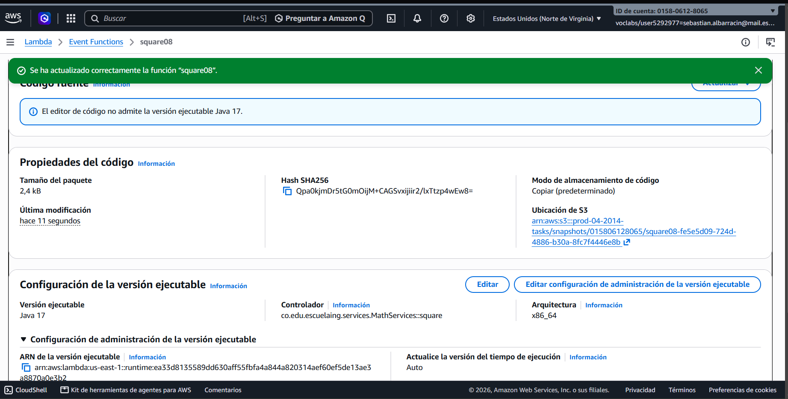
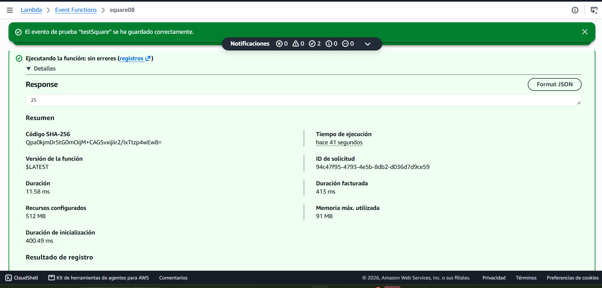
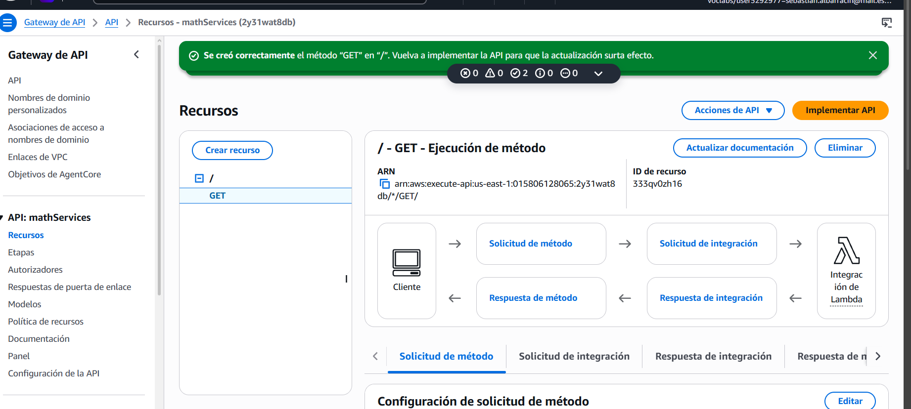
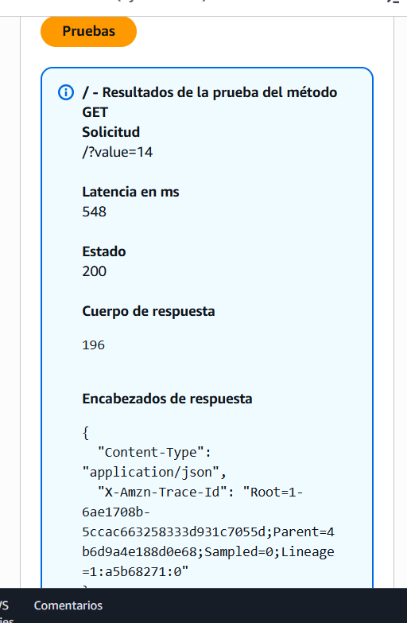

# Hello World: AWS Lambda & API Gateway en Java

Microservicio REST que recibe un entero y devuelve su cuadrado. La lógica está en Java, se despliega como una función **AWS Lambda** y se publica en internet con **AWS API Gateway**.

```
GET https://2y31wat8db.execute-api.us-east-1.amazonaws.com/Beta?value=14   →   196
```

## Autor

Sebastian Albarracin

## Arquitectura

```
Cliente (navegador / curl)
        │  GET /Beta?value=14
        ▼
API Gateway (mathServices, REST, Regional)
        │  Mapping template: $input.params("value")  →  14
        ▼
AWS Lambda (square08, Java 17)
        │  co.edu.escuelaing.services.MathServices::square
        ▼
      196
```

API Gateway toma el parámetro `value` de la URL y, mediante una plantilla de mapeo, le pasa a la Lambda **solo el número** en lugar de un objeto JSON. Por eso el handler puede ser un método estático muy simple que recibe un `Integer`.

## Estructura del proyecto

```
src/main/java/co/edu/escuelaing/services/MathServices.java       # lógica del servicio (handler)
src/test/java/co/edu/escuelaing/services/MathServicesTest.java   # pruebas unitarias
pom.xml
```

```java
package co.edu.escuelaing.services;

public class MathServices {

    public static Integer square(Integer i) {
        return i * i;
    }
}
```

No tiene dependencias de AWS: Lambda deserializa la entrada directamente al tipo `Integer`.

## Compilación y pruebas

Requisitos: JDK 17 y Maven 3.

```bash
mvn package
```

Ejecuta las pruebas unitarias (casos positivo, negativo y cero) y genera `target/math-services-1.0-SNAPSHOT.jar`, que es el artefacto que se sube a Lambda.

```
Tests run: 3, Failures: 0, Errors: 0, Skipped: 0
```

El proyecto compila para Java 17 porque AWS Lambda ya no permite crear funciones nuevas con el runtime Java 8.

## Despliegue

### 1. Función Lambda

| Configuración | Valor |
|---------------|-------|
| Nombre | `square08` |
| Runtime | Java 17 |
| Rol de ejecución | `LabRole` (AWS Academy) |
| Código | `math-services-1.0-SNAPSHOT.jar` |
| Handler | `co.edu.escuelaing.services.MathServices::square` |

Probé la función con un evento de prueba (`testSquare`) cuyo contenido es solo el número `5`, sin JSON, y la respuesta fue `25`.

### 2. API Gateway

| Configuración | Valor |
|---------------|-------|
| API | `mathServices` (REST, endpoint Regional) |
| Método | `GET` sobre `/`, integración Lambda con `square08` (sin proxy) |
| Method request | Query string `value` (requerido) |
| Integration request | `value` ← `method.request.querystring.value` |
| Mapping template (`application/json`) | `$input.params("value")` |
| Stage | `Beta` |

La plantilla de mapeo extrae el parámetro `value` de la URL y se lo pasa a la Lambda como un número, sin envolverlo en JSON. En la consola, la prueba del método con `value=14` devolvió estado `200` y cuerpo `196`. Por último desplegué el API en el stage `Beta` y lo invoqué desde el navegador:

```
https://2y31wat8db.execute-api.us-east-1.amazonaws.com/Beta?value=14
```

Respuesta: `196`.

### 3. Limpieza

Después de las pruebas eliminé la función Lambda `square08` y el API `mathServices` para no generar costos.

## Evidencias

| Paso | Captura |
|------|---------|
| Función Lambda creada |  |
| Test de Lambda con `5` → `25` |  |
| Método GET en API Gateway |  |
| Test en API Gateway con `value=14` → `196` |  |
| Invocación desde el navegador |  |

## Conclusiones

- Con Lambda y API Gateway se puede publicar un microservicio sin administrar servidores: solo se sube el código y se configura cómo llega la petición.
- Las plantillas de mapeo de API Gateway definen exactamente qué recibe la función. En este caso se envía un único valor, pero en servicios reales lo normal es enviar objetos JSON que Lambda convierte a POJOs.
- En Java, la entrada y la salida del handler pueden ser tipos primitivos o `String`, eventos predefinidos de `aws-lambda-java-events` (por ejemplo `S3Event`) o POJOs propios, que Lambda serializa y deserializa automáticamente.
